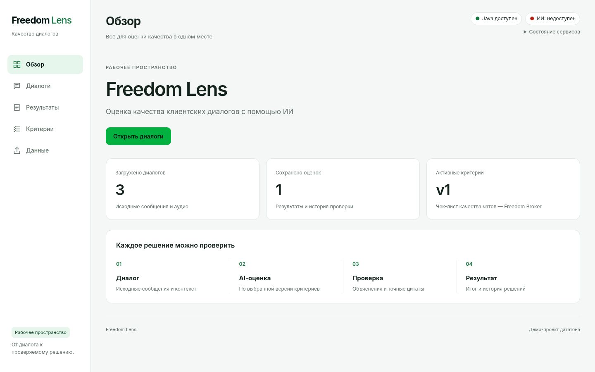

# Freedom Lens

**Оценка качества клиентских диалогов с помощью ИИ.**

Загрузите разговор, выберите критерии и получите оценку с объяснениями и точными
цитатами. Проверьте доказательства, подайте апелляцию или измените критерии —
история предыдущих версий и первоначальная оценка сохранятся.

Демо-проект CQA Datathon. Интерфейс на русском, диалоги — RU / KZ / EN.



## Что можно проверить

- Импорт JSON и загрузку следующего набора по `group_id`.
- Поиск и фильтры диалогов, исходные роли, время, сообщения и доступное аудио.
- AI-оценку при разрешённой конфигурации или ручную оценку без модели.
- Итог /100, N/A, отдельный флаг грубого нарушения и переход к точной реплике.
- Изменение любого критерия через UI с созданием новой версии чек-листа.
- Апелляцию и решение проверяющего: Original неизменен, Final пересчитывается.
- Массовую оценку: закреплённая версия, прогресс, пауза, продолжение и восстановление.

## Стек

| Компонент | Технологии |
| --- | --- |
| Приложение и API | Java 21, Spring Boot, JDBC |
| Интерфейс | HTML, CSS, Vanilla JavaScript; раздаётся Java |
| Хранилище | SQLite |
| ML-сервис | Python, FastAPI; отдельный HTTP-процесс |
| Модель | Groq `openai/gpt-oss-20b` |

Баллы считает Java; модель возвращает ответы, объяснения и evidence.
React, Node.js и отдельная сборка frontend для запуска приложения не нужны.

## Быстрый запуск

Инструкция для Linux/macOS, Bash. Нужны **JDK 21** (`java` и `javac`), Git и curl.
Maven Wrapper скачает нужный Maven; первый запуск требует доступа к Maven Central.
Python 3.12+ с venv понадобится только для ML и offline-проверки ниже.

### 1. Скачать актуальный main и собрать

```bash
git clone --branch main https://github.com/Pandaman-8/freedom-cqa-datathon.git
cd freedom-cqa-datathon
./server/mvnw -f server/pom.xml -DskipTests package
```

Тесты запускаются отдельно — команды в конце README.

### 2. Запустить приложение без внешних вызовов

Из корня репозитория:

```bash
CQA_ML_URL= CQA_ORGANIZER_URL= \
  java -jar server/target/freedom-cqa-server-0.1.0.jar
```

Откройте **http://127.0.0.1:8080/**. Остановка — **Ctrl+C**.
В этом режиме работают импорт, критерии, ручная оценка и апелляции; ИИ честно
показывается как недоступный. Ключи и Python для этого шага не нужны.

Проверка сервера из другого терминала:

```bash
curl --fail -sS http://127.0.0.1:8080/api/health
```

Ожидается `status: "ok"`. Это проверка Java, а не готовности модели.
История хранится в `~/.local/share/freedom-cqa/java/cqa.sqlite` и остаётся после
перезапуска. Для отдельной базы задайте **абсолютный** `CQA_DB_PATH` при запуске.
Не запускайте два Java-процесса с одной базой.

### 3. Проверить интерфейс

1. **Данные → Импортировать JSON**: выберите `examples/synthetic_dataset.json`
   из клонированного репозитория. Это два учебных диалога, не DEV/CONTROL.
2. **Диалоги**: выберите разговор, прочитайте сообщения, выберите чек-лист и версию.
3. Раскройте **Оценить вручную**: заполните ответы и обоснования, добавьте точные
   цитаты из сообщений, сохраните оценку.
4. В **Результатах** откройте **Показать доказательство** — интерфейс перейдёт к
   исходной реплике. Через **Оспорить оценку** создайте апелляцию.
5. **Критерии → Изменить критерий → Сохранить новую версию** создаёт v2.
   Предыдущие оценки остаются привязаны к v1.

Этот учебный JSON предназначен для импорта и ручной работы. Он **не входит** в
список разрешённых AI-входов; для автоматической проверки используйте следующий раздел.

## Проверить весь AI-процесс без ключа

Для технической проверки доступен изолированный **offline provider**: настоящие
Java и Python HTTP-сервисы, временная SQLite и существующие синтетические fixtures.
Это тест интеграции, **не настоящие ответы Groq и не оценка качества модели**.

Из корня репозитория:

```bash
python3 -m venv ml-service/.venv
ml-service/.venv/bin/python -m pip install -r ml-service/requirements.txt
ml-service/.venv/bin/python -B server/src/test/python/admission_dev_smoke.py \
  --synthetic-fixtures --ml-python "$PWD/ml-service/.venv/bin/python" --serve
```

Дождитесь напечатанного адреса `http://127.0.0.1:<порт>/__tests/` и откройте его.
Нажмите **Run offline admission regression** один раз. Девять сценариев проверяют
импорт, оценку по восьми критериям, evidence, апелляцию, изменение критерия v1→v2,
подтверждение рубрики, batch, ошибки и восстановление после перезапуска.

После завершения откройте `/` на **том же адресе и порту** для просмотра workspace
и сохранённых результатов. Объяснения помечены **OFFLINE TEST ONLY**.
В наборе пять допустимых чатов и один звонок, который блокируется этой политикой.
Внешняя сеть тестового ML-процесса запрещена. Enter в терминале завершит стенд и
удалит только его временную базу. Для повторного полного теста запустите стенд заново.

## Настоящий AI через Groq

Нужны Python-окружение из предыдущего раздела, действующий ключ Groq и подтверждённый
Free Plan аккаунта. Создайте приватный `ml-service/.env` по
[примеру](ml-service/.env.example): задайте `GROQ_API_KEY`,
`GROQ_MODEL=openai/gpt-oss-20b`, `ML_DATA_POLICY=synthetic_only` и
`GROQ_FREE_PLAN_CONFIRMED=true` **только после проверки плана аккаунта**.
Этот флаг не является техническим лимитом расходов. Не публикуйте `.env` и ключ.

Терминал 1, из корня репозитория:

```bash
ml-service/.venv/bin/python -m uvicorn app.main:app \
  --app-dir ml-service --env-file ml-service/.env \
  --host 127.0.0.1 --port 8001 --workers 1 --no-access-log
```

После настройки можно явно проверить **один существующий синтетический сценарий**:

```bash
ml-service/.venv/bin/python ml-service/scripts/smoke.py --case kz_public_na
```

Эта команда действительно вызывает Groq через Python и может сделать до двух
provider attempts. Она не записывает результат в Java/SQLite. Успешный HTTP-ответ
и точные цитаты сами по себе не доказывают правильность суждений модели.

Для UI остановите Java из Quick Start и запустите её с тем же хранилищем:

```bash
CQA_ORGANIZER_URL= CQA_ML_URL=http://127.0.0.1:8001/v1/evaluate \
  java -jar server/target/freedom-cqa-server-0.1.0.jar
```

<a id="новый-набор-и-approval-v2"></a>

Подключение ML само по себе не разрешает отправку любого разговора.
По умолчанию Java допускает только шесть точных пар «диалог + чек-лист» из fixtures.
Для DEV/CONTROL и новых версий C01–C08 требуется отдельно согласованный режим
`approved_dataset`: [приватное разрешение и настройка обеих служб](docs/DYNAMIC_ADMISSION.md#настройка-приватного-разрешения).
Ни имя группы, ни выбор модели не означают согласия на внешнюю передачу.

Без ключа/подтверждения Python возвращает health 503; недоступность и ошибки
показываются в UI, фиктивного успешного результата нет. После timeout сначала
проверьте статус запроса: автоматической повторной отправки нет.

## Критерии, новые версии и апелляции

Начальный чек-лист `chat-quality / v1` содержит:

| ID | Критерий | Вес |
| --- | --- | ---: |
| C01 | Установление контакта | 10 |
| C02 | Выявление потребности | 15 |
| C03 | Идентификация | 20 |
| C04 | Корректная и полная консультация | 20 |
| C05 | Эмпатия и клиентоориентированность | 15 |
| C06 | Управление диалогом, скорость и грамотность | 15 |
| C07 | Завершение | 5 |
| C08 | Грубые ошибки | Отдельный флаг |

N/A допустим только там, где он разрешён критерием; его вес исключается из расчёта.
C08 не обнуляет числовой балл. Полная сверка с оригинальным checklist PDF пока
невозможна: файл `data/official/chat_quality_checklist.pdf` отсутствует.

В **Критериях** можно менять инструкции, разделы, веса, шкалы и правила N/A.
После сохранения нажмите **Оценить по новой версии**. Для разрешённой AI-сессии
новая версия внутри согласованного диапазона не требует правки Java/Python или prompt;
перед отправкой рубрику нужно подтвердить заново. Старые результаты не изменяются.

В **Результатах → Оспорить оценку** укажите критерий и причину. Проверяющий подтверждает
ответ либо заменяет его с обоснованием и evidence. Original сохраняется, Final
пересчитывает Java; решение остаётся в истории. При конфликте изменений перечитайте
состояние и проверьте черновик перед новой явной отправкой.

## Демонстрация до пяти минут

Сборку, настройку и проверку доступа выполняйте **до начала защиты**.
Назовите используемый режим: настоящий Groq, сохранённые результаты или offline-тест.

| Время | Что показать |
| --- | --- |
| 0:00–0:35 | Обзор, импорт/выбор группы, диалог и фильтры RU/KZ/EN. |
| 0:35–1:45 | Выбранный чек-лист, разрешённая AI-оценка, итог /100. |
| 1:45–2:15 | Объяснение, N/A и переход по evidence к реплике. |
| 2:15–2:50 | Апелляция, решение проверяющего, различие Original/Final. |
| 2:50–3:20 | Изменение критерия и сохранение v2. |
| 3:20–4:30 | Оценка по v2 и сохранность истории v1. |
| 4:30–4:50 | Результаты → Массовая оценка: версия, прогресс, пауза/продолжение. |

Задержка провайдера не гарантируется. Для соблюдения лимита можно показать заранее
сохранённые результаты, прямо назвав это. [Подробный сценарий и подготовка](docs/DEMO.md).
Student Guide v3 требует открытый репозиторий, понятный README запуска и защиту
максимум за пять минут; отдельный шаблон README не установлен.

## DEV/CONTROL и ограничения

- Наборы организаторов и ключи не входят в публичный репозиторий. Новый набор можно
  импортировать через UI или загрузить по `group_id`, настроив приватный
  `CQA_ORGANIZER_URL` по [инструкции Java](server/README.md). Менять исходники не нужно.
- Импорт сохраняет точные байты JSON в приватный `dataset-sources/` рядом с SQLite.
  Для внешней AI-обработки нужны согласованные условия передачи и действующий grant.
  Чаты с аудиоссылками и звонки не допускаются в этом режиме; анализ интонации не заявляется.
- Качество текущего Prompt v4 на настоящем CONTROL, фактическая стоимость и скорость
  не подтверждены offline-тестами. Предыдущие live-прогоны не заменяют новую приёмку.
- Batch восстанавливается в том же браузере, по тому же адресу и с той же SQLite.
  После перезагрузки отправка возобновляется только явно; неизвестный исход не повторяется автоматически.
- Приложение предназначено для локального показа, без аутентификации. Не открывайте его
  в интернет. DEV/CONTROL, аудио, приватные URL, официальные PDF, `.env` и SQLite не публикуются.

## Тесты и документация

Для JS-тестов нужен Node.js 22. Из корня репозитория:

```bash
./server/mvnw -f server/pom.xml clean verify
node --experimental-default-type=module --test server/src/test/js/*.test.mjs
python3 server/src/test/python/scoring_reference.py --check
python3 -B scripts/check-public-safety.py
```

ML-регрессии без внешнего провайдера:

```bash
ml-service/.venv/bin/python -m pip install -r ml-service/requirements-dev.txt
GROQ_API_KEY= GROQ_FREE_PLAN_CONFIRMED=false PYTHONPATH=ml-service \
  ml-service/.venv/bin/python -B -m pytest -q ml-service/tests
```

- [Проверка контракта 2.0.0 и 72 fixtures](contracts/README.md).
- [Результаты проверок UI и скриншоты](docs/FREEDOM_LENS.md), [готовность и блокеры](docs/RELEASE_READINESS.md).
- [Java/UI](server/README.md), [Python ML](ml-service/README.md), [архитектура](docs/architecture.md).
- [Приватный допуск AI](docs/DYNAMIC_ADMISSION.md), [задачи](plan.json), [правила разработки](AGENTS.md).

Каталоги `backend/` и `frontend/` сохранены как legacy; для запуска Freedom Lens они не нужны.
