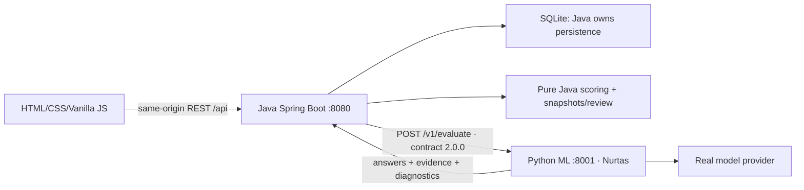

# Freedom CQA — независимый технический аудит

Дата: 7 ноября 2026, Asia/Almaty. Код: `a8261f5`. Это аудит и проектирование, не реализация. Статусы будущих задач ведутся только в [plan.json](../plan.json).

> **Редакция java-vanilla-http-ml/2.** Следующие сведения относятся к старому Python/React фундаменту, а не к готовности Java. Исторические предложения и task references в этой части не определяют текущую реализацию: действующие назначения — в plan.json и разделе Architecture Migration Decision ниже. Повторный полный аудит не проводился.

## Исторический вывод и границы проверки
Фундамент backend пригоден для продолжения: разделение FastAPI/storage/evaluator/scoring разумно; импорт, версии и последовательный ручной review работают. Демонстрируемый продукт пока не готов: frontend падает при рендере, автоматическая оценка возвращает 501, UI не показывает обязательные баллы критериев/секции и не выбирает разные чек-листы. Самая важная интеграционная ошибка — повторное чтение latest checklist при сохранении ответа.

Прочитаны AGENTS.md, README, все исходные docs, seed, весь backend/frontend, тесты, scripts, manifests и CI. Доступный Student Guide прочитан полностью. Ничего из production-кода или тестов в рамках планирования не менялось. Доступ к реальному provider, upstream API, аудиоплееру и remote GitHub не проверялся; никаких платных вызовов или публикации данных не было.

## Источники и степень достоверности
- **S1** — `data/official/student_guide_v3.pdf`; `official`, `read`. Все 4 страницы извлечены в память; стр.2 визуально проверена; метаданные ссылки стр.3 изучены. PDF содержит signed API URI с sig. Не публиковать файл/ссылку.
- **S2** — `data/official/chat_quality_checklist.pdf`; `official`, `missing`. Файл отсутствует; точные формулировки/NA/scales/rounding не сверены с оригиналом. 
- **S3** — `data/dev/invoke.json`; `dataset`, `read`. Все записи структурно проверены; семантический gold не размечен, аудио не скачано/не прослушано. В документах только агрегаты и номера кандидатов, никаких реплик/URL.
- **S4** — `backend/; frontend/; tests/; scripts/; .github/`; `implementation`, `read_and_exercised`. 13 existing tests in-memory; Vite write:false; runtime render; 5184 scoring combinations; synthetic defect probes. 
- **S5** — `backend/app/seed/chat_quality.json`; `repository_provisional`, `read`. 8 критериев согласуются с ориентировкой пользователя; дословность относительно S2 не доказана. 
- **S6** — `AGENTS.md; README.md; docs/requirements.md; docs/architecture.md; docs/api-contract.md; docs/ml-contract.md`; `repository_secondary`, `read`.  
- **S7** — `user_request`; `user_scope`, `read`. Разрешены ровно четыре planning artifacts, запрещены implementation/commit/push/paid calls/private publication. 

S1: стр.1 — задача, формат и контроль; стр.2 — шесть функциональных действий; стр.3 — API/формат/роли/время; стр.4 — сдача, 5 минут, H23/H24, модель/стоимость/CORS/audio. S2 отсутствует: утверждение README о «прямой транскрипции PDF» независимо не подтверждено. Требования версионирования, строгого ML-контракта и приватности дополнительно заданы пользователем/AGENTS, а не выдаются за дословные пункты Student Guide. Проценты оценки жюри нигде не выдумываются.

## Историческая матрица требований старого фундамента
Матрица ссылается на устойчивые ID задач. «Реализовано» здесь означает наличие backend/компонентов; до T03 не означает рабочий UI в браузере.

| ID / Requirement | Source | Current implementation | Gap | Priority | Planned task | Verification |
|---|---|---|---|---|---|---|
| R01 — Редактор criterion/wording/weight/type/scale/NA | S1:p2 | Editor/API есть, runtime сломан. | Восстановить UI и browser verification. | P0 | T03, T12, T14 | Произвольный новый criterion применяется без code edits. |
| R02 — 8 начальных критериев из официального PDF | S1:p1;S2 | Seed соответствует ориентировке пользователя. | S2 отсутствует; дословность не доказана. | P0 | T01, T09 | Каждый instruction/NA/level сверён с PDF. |
| R03 — Версии и неизменяемость истории | S7;S6 | Append-only checklist есть; evaluation берёт latest. | Pin version и score snapshot. | P0 | T05, T06 | Concurrent edit не меняет evaluation version/history. |
| R04 — Получение DEV/CONTROL по group_id | S1:p1,p3,p4 | Работает импорт готового JSON. | Нет backend GET-adapter/UI group_id. | P0 | T07, T17, T20 | Два group_id загружаются без browser credentials; upload fallback сохранён. |
| R05 — Выбор checklist и автоматическая оценка | S1:p2 | API keys поддерживает; UI hardcodes chat-quality; auto501. | Selector и настоящий adapter. | P0 | T08, T10, T11, T12, T13 | Real evaluation сохранена с выбранными key/version. |
| R06 — RU/KZ/EN | S1:p1,p2 | Импорт/вывод работают, ML нет. | Language quality. | P0 | T09, T15 | Минимум 2 размеченных собственных synthetic cases на язык, human review. |
| R07 — Оператор отдельно от bot/system | S1:p2 | Роли сохраняются, semantic evaluator нет. | Role/order prompt и tests. | P0 | T09, T10, T15 | Bot greeting не засчитан; system verification учтён в последовательности. |
| R08 — Исходные timestamps и стабильные message IDs | S1:p3;S7 | Строки и positional mNNNN сохраняются. | Регрессии повторов/ISO calls; не переписывать importer. | P0 | T04, T16 | Одинаковые timestamps не склеивают сообщения; строки не преобразованы. |
| R09 — Ответ, баллы, вес, explanation, evidence | S1:p2 | API всё считает; UI не выводит earned/effective weights. | Полная карточка. | P0 | T12, T13 | Scale7/10 weight15 → raw10.5 и правильный normalized contribution. |
| R10 — Переход к message/audio fragment | S1:p2 | Message jump/player реализованы, audio seek нет. | Рабочий UI, jump verification; Q02 для calls. | P0 | T12, T15, T16 | Evidence jump ведёт к нужному ID при одинаковом времени; playback/link доступен. |
| R11 — NA reason и checked context для omission | S1:p2 | Schema требует evidence; substring проверяет наличие, не смысл. | NA rule UI и semantic cases. | P0 | T04, T09, T11, T12, T15 | NA исключает вес; omission имеет настоящие context quotes. |
| R12 — Нормализация весов, шкал и total | S1:p2;S5 | 5184 сочетания совпали с независимым Fraction reference. | Finite-input validation; math сохранить. | P0 | T04, T16 | Illegal level/NA rejected; custom all-NA→null, maximum100. |
| R13 — Итоги секций при заданных sections | S1:p2 | Backend есть, UI нет. | Section scores/NA output. | P0 | T12 | Секция без веса→NA; проценты секций не суммируются. |
| R14 — Грубая ошибка отдельно | S1:p2;S5 | C08 flag не штрафует total. | Сохранить после ML/review. | P0 | T09, T14, T16 | 100 + flag возможно; total не обнуляется. |
| R15 — Апелляция criterion/comment | S1:p2 | API/UI есть; неатомарный duplicate check. | Atomic uniqueness, AI E2E. | P0 | T06, T14 | Concurrent create→одна open запись и201/409. |
| R16 — Reviewer reason, original/final, recalculation | S1:p2 | Sequential flow работает; original score пересчитывается при GET. | Snapshot/atomic decisions/original details. | P0 | T06, T12, T14 | Решение не переписывается, original immutable, final derived. |
| R17 — Новый criterion в UI на control | S1:p1,p4 | Manual added-criterion test есть; ML отсутствует. | Real dynamic-model E2E. | P0 | T10, T14, T20 | Новый ID/type/levels/NA применён без source/prompt edits. |
| R18 — Прослушивание или player link | S1:p2,p3 | Audio element+link есть; реальные URLs не проверены. | Local playback/expiry handling. | P0 | T15 | Воспроизведение/ссылка проверены или явная ошибка; no unsupported prosody claim. |
| R19 — Публичный GitHub и воспроизводимый запуск | S1:p4 | README/CI есть; lock untracked; remote не проверен. | Pinned deps/runtime smoke/fresh launch. | P0 | T18 | Clean checkout запускается; публичность и передача ссылки проверены человеком. |
| R20 — HTML/CSS/JS и без регистрации | S1:p1,p4 | React/Vite без login. | Runtime fix, component boundaries. | P0 | T03, T19 | Demo без login; Dynamics deployment сейчас не требуется. |
| R21 — Модель/стоимость paid evaluation | S1:p4 | Provider/usage/cost нет. | Все попытки учитываются. | P0 | T08, T10, T17, T19 | Actual model и summed cost disclosed; unknown не равен0. |
| R22 — H23 CONTROL/H24 freeze/≤5min | S1:p4 | Release/demo не проверены. | Rehearsal, freeze, UI-only changes. | P0 | T17, T19, T20 | ≤300s; frozen commit; CONTROL не заменён DEV. |
| R23 — Privacy public repo/external model | S7;S1:p4 | data gitignored; PDF содержит signed API link. | Policy, backend secrets, safe errors/release scan. | P0 | T07, T08, T11, T18, T20 | No real data/audio/tokens in git/logs/bundle; no unauthorized external submission. |
| R24 — Для дикции/интонации нужен звук | S1:p4 | Audio analysis отсутствует. | Уточнить обязательность, не изобретать rubric. | P2 | T01, T26 | При обязательности отдельный согласованный audio scope; иначе disclosed limitation. |

## Scoring: подтверждённая арифметика и несверенные правила
Ниже именно текущая конфигурация S5 и ориентировка пользователя. Без S2 нельзя называть дословно проверенными официальные формулировки и все условия N/A.

| ID | Вес / ответ | Текущая инструкция и N/A |
|---|---|---|
| C01 — Установление контакта | 10; yes/no | Да — оператор поздоровался на языке клиента и представился в первом ответе. N/A запрещён. |
| C02 — Выявление потребности | 15; yes/no/N/A | Да — оператор учёл известные детали и уточнил недостающее до ответа. N/A: Данных для ответа хватало с самого начала. |
| C03 — Идентификация | 20; yes/no/N/A | Да — проверка личности подтверждена до раскрытия данных или защищённого действия. N/A: Запрос не требовал идентификации. |
| C04 — Корректная и полная консультация | 20; 0/5/10/15/20/N/A | Оцените ответ или следующий шаг по заданной шкале; учитывайте все существенные вопросы клиента. N/A: Чат закончился до того, как клиент сформулировал запрос. |
| C05 — Эмпатия и клиентоориентированность | 15; yes/no | Да — оператор вежлив и, если клиент выразил недовольство или описал неудобство, отреагировал на конкретную проблему. N/A запрещён. |
| C06 — Управление диалогом, скорость и грамотность | 15; 0/4/7/10 | Оцените ясность, порядок ответов и предупреждение об ожидании. Порог первой реакции в 3 минуты, теги и вложения здесь не оцениваются. N/A запрещён. |
| C07 — Завершение | 5; yes/no/N/A | Да — оператор подвёл итог или предложил дальнейшую помощь и попрощался. N/A: Чат оборвался до возможности его завершить. |
| C08 — Грубые ошибки | 0; yes/no flag | Да — обнаружено хотя бы одно: оскорбление клиента, предложение платной услуги в обход компании или раскрытие конфиденциальной информации. Самого предложения обходной услуги достаточно. N/A запрещён. |

Для применимых взвешенных критериев `raw_i = weight_i × ratio_i`, где binary yes/no → 1/0, scale → выбранный уровень / максимум именно настроенной шкалы. `W = сумма применимых весов`; `total = round_half_up(100 × Σraw_i / W, 2)`. N/A убирает и числитель, и вес из знаменателя. При W=0 total/max_score=null. Flag-критерии не входят в W и не штрафуют total. Правила не зависят от конкретных ID.

Проверено 5 184 допустимых сочетания исходного seed независимым эталоном на `fractions.Fraction` и целочисленном HALF_UP: все totals совпали; отдельный C08 flag также совпал. Проверка не использовала calculate для построения эталонного результата. Например, C03=N/A и C06=7 при остальных полных баллах: W=80; raw C06=10.5; total=94.38; normalized contribution C06=13.13. Все ответы полные плюс C08=yes → 100 и отдельный флаг.

Edge cases: custom checklist с единственным weighted allow_na и ответом NA даёт null; default seed не может стать полностью NA из-за C01/C05/C06. Empty applicable section → percent=null. Секции сейчас нормализуются внутри себя: `100 × section_raw / section_applicable_weight`. Это не вклады в total, проценты секций нельзя складывать. Total считается до округления строк, поэтому сумма отображённых строк может отличаться на 0.01 — сама по себе это не ошибка.

Найден реальный дефект расширяемой конфигурации: ScaleLevel принимает Infinity; выбранный бесконечный уровень вызывает `decimal.InvalidOperation`. Поля explanation/quote допускают строку из пробелов. Требуются finite/nonblank validators, но переписывать корректную арифметику не нужно. Положительные веса weighted-критериев, шкала с минимумом 0 и минимум двумя уровнями — текущие ограничения реализации, не отдельные требования, доказанные по PDF. Точные половины ROUND_HALF_UP и исключение 3-минутного порога/тегов/вложений пока опираются на S5/S6/пользователя, а не прочитанный S2.

## DEV: факты без приватных реплик

| Проверка | Результат |
|---|---|
| Записи | 65; declared count совпадает; duplicate conversation IDs: 0 |
| Языки | RU35 / KZ15 / EN15 |
| Каналы | 60 agent chat / 5 voice call; все calls RU |
| Реплики | 1 268: client505, bot315, system109, operator339 |
| Реплик на диалог | min11 / median14 / max115 |
| Символы текста | всего84 054; min769 / median990 / max5 089 на диалог |
| Время | Все chats соответствуют MM:SS, все calls ISO8601 с зоной; убываний не найдено |
| Повтор времени | В41 диалоге; 41 повторное вхождение |
| Полный дубликат turn | 1: локальная запись63, реплики20 и21, client; не удалять автоматически |
| Пустые text | 0; пустых transcripts нет, DatasetEnvelope принят |
| Audio | 5 HTTPS URLs, все с sig; у chats null, у calls ссылки присутствуют |

Самый длинный диалог — локальная запись №65 (115 сообщений, 5 089 символов). Остальные calls №61–64 имеют 78/73/45/75 сообщений и 3 795/3 690/3 934/4 696 символов. Это небольшой объём символов, но token count нужно измерить выбранным tokenizer вместе с длинным rubric/prompt. Нельзя заранее утверждать, что выбранная модель не потребует ограничения context.

Схема фактически имеет envelope `error/isSuccess/data`; data — `dataset_group_id/total_records/records`; record — `conversation_id/channel/language/transcript/audio_url`; message — `timestamp/speaker/text`. Никакой унификации chat и call timestamps не требуется. Даже полностью одинаковые turns сохраняются: position ID защищает evidence и порядок событий.

### Кандидаты для локальной разметки качества
Это воспроизводимые порядковые номера records (1-based), не опубликованные IDs/тексты и **не gold-оценки**. Кандидаты отобраны локальными структурными/лексическими признаками; наличие слова не доказывает правильность, нарушение или N/A. Финальную разметку делает Nurtas до просмотра model output; собственные synthetic аналоги создаются независимо и только они попадают в Git.

| Сценарий | Кандидаты | Что проверить вручную |
|---|---|---|
| Возможное успешное обслуживание | №1,6,10 | Решены ли все вопросы; благодарность не доказывает полноту |
| Неполная консультация/недовольство | №5,17,29 | Какие вопросы остались; отделить эмпатию от полноты |
| Идентификация | №2,6,10,33,42,45,51,59 | Порядок system verification и protected action |
| Безопасность | Те же identity cases + собственный synthetic контрпример | Есть ли нарушение до verification; не назначать No по слову «счёт» |
| Возможная обходная платная услуга | №43 | Контекст/предложение; совпадение paid/private — не установленная грубая ошибка |
| N/A | №1,12,20,34,51 для просмотра + отдельные synthetic C02/C03/C04/C07 | Проверить точное условие каждого NA; не автоматически NA при неопределённости |
| Незавершённый диалог | №12,20,34,37,42,51 | Кто и когда прервал; имелась ли возможность закрытия |
| KZ | №31–45; начать с33,34,43 | Независимая языковая проверка, не переводить source quotes |
| EN | №46–60; начать с51,59 | Identity/order/NA на исходном английском |
| Длинный call | №65, затем61–64 | Весь контекст и internal consultation; реальные voice выводы сверять со звуком |

Упоминания внутренних консультаций найдены лексически в части звонков; фактические ASR-ошибки и клиентская адресация реплик не подтверждались прослушиванием. Утверждение S6 об ASR-артефактах остаётся предупреждением, а не доказанной оценкой конкретного оператора. До согласования Q02 можно сохранять/показывать transcript, оценивать подтверждённые текстовые действия и открывать audio. Нельзя самостоятельно добавлять voice penalty, оценку дикции/интонации по тексту или audio offset из абсолютного ISO timestamp без начала записи.

## API и persistence: текущее состояние

| Method | Endpoint | Фактическое поведение |
|---|---|---|
| GET | `/api/health` | Hardcoded unconfigured |
| POST | `/api/datasets/import` | Atomic JSON import |
| GET | `/api/conversations` | Max2000 |
| GET | `/api/conversations/{id}` | Original + positional messages |
| GET | `/api/checklists` | Latest per key |
| GET | `/api/checklists/{key}?version=N` | Current/historical |
| POST | `/api/checklists/{key}` | Create, reserved default key |
| PUT | `/api/checklists/{key}` | Append version, no expected_version |
| POST | `/api/evaluations/manual` | Implemented, latest version |
| POST | `/api/evaluations/auto` | 501 |
| GET | `/api/evaluations?conversation_id=...` | Global max200, full recalculation |
| GET | `/api/evaluations/{id}` | Original/final calculated at read |
| POST | `/api/evaluations/{id}/appeals` | Non-atomic duplicate check |
| POST | `/api/appeals/{id}/resolve` | Non-atomic status check |

Import использует BEGIN IMMEDIATE и canonical JSON hash: «different bytes» в architecture docs неточно — изменение JSON formatting несущественно, а audio_url входит в hash. Versions сохраняются транзакционно. Evidence проверяет существующий ID и exact substring; семантическую релевантность это не доказывает. Текущие Pydantic models в основном coercive/extra-ignore; output API преимущественно dict, строгий ML result envelope ещё не определён. Предлагаемая миграция не должна менять CriterionAnswer поля без согласования.

## Дефекты по степени влияния
BLOCKER — отсутствует обязательный workflow; HIGH — серьёзный риск integrity/integration; MEDIUM — исправить по возможности; LOW — после MVP. Приоритет задачи и severity — разные понятия: некоторые MEDIUM validators входят в дешёвый P0 hardening.

### F01 · BLOCKER · React is not defined
Файл: `frontend/src/App.jsx:1; ChecklistEditor.jsx:1; ManualEvaluation.jsx:1; ReviewWorkspace.jsx:1`. Причина: Classic JSX требует React binding; imported только hooks.

Проверка: Production build passed; compiled App render failed. Влияние: Все UI workflows недоступны.

Исправление: Automatic runtime либо imports + browser smoke. Задачи: T03, T16.

### F02 · BLOCKER · AI отсутствует
Файл: `backend/app/evaluator.py:13; main.py:96`. Причина: UnconfiguredEvaluator намеренная заглушка.

Проверка: Existing API test501. Влияние: Нет обязательной auto evaluation.

Исправление: Настоящий adapter с dynamic checklist/validation/cost. Задачи: T08, T09, T10, T11, T13.

### F03 · HIGH · Version race при сохранении evaluation
Файл: `schemas.py:116; storage.py:180; main.py:96; ManualEvaluation.jsx:41`. Причина: No version in request; save читает latest повторно.

Проверка: Synthetic v1/90 сохранён по v2/90.91; auto выбирает latest после evaluate. Влияние: Тихая подмена rubric/weights.

Исправление: Explicit required version, pinned snapshot throughout. Задачи: T05.

### F04 · BLOCKER · Неполный UI checklist/result
Файл: `frontend/src/App.jsx:61; ReviewWorkspace.jsx:64`. Причина: Hardcoded key; no section/earned/effective weights rendering.

Проверка: Статический просмотр, backend fields существуют. Влияние: Невыполнены Guide p2 select checklist/criterion points/sections.

Исправление: Selector/create-copy и полный output backend scoring. Задачи: T12.

### F05 · HIGH · Нет group_id backend fetch
Файл: `backend/app/main.py:33; frontend/src/App.jsx:69`. Причина: Only uploaded envelope.

Проверка: Нет upstream route в коде. Влияние: CONTROL нельзя получить через UI; JSON fallback есть.

Исправление: Backend GET adapter с env URL; UI group_id. Guide описывает GET, встроенный fetch — выбранное полное решение. Задачи: T07.

### F06 · HIGH · Перезапись reviewer decision
Файл: `backend/app/storage.py:250,269`. Причина: Non-atomic read/status check; нет UNIQUE open-appeal index.

Проверка: Контролируемое чередование: B resolved, stale A перезаписал reason; duplicate create risk по коду. Влияние: Нарушена история решения при двух запросах.

Исправление: Short BEGIN IMMEDIATE, conditional update+revision+unique open. Задачи: T06.

### F07 · HIGH · Original score не сохранён
Файл: `backend/app/storage.py:59,211`. Причина: GET пересчитывает original текущим calculate.

Проверка: Схема/код подтверждают; историческую смену scorer не запускали. Влияние: Будущая math edit меняет исторический original.

Исправление: Snapshot + scoring_version; marked backfill, pinned review calculator. Задачи: T06.

### F08 · MEDIUM · Слабая finite/text validation
Файл: `backend/app/schemas.py:12,103,108`. Причина: Infinity разрешён для levels; пробелы проходят min_length.

Проверка: Infinity принят, calculate→Decimal InvalidOperation; blank explanation принят. Влияние: Некорректная конфигурация/ML output дают500 или пустое обоснование.

Исправление: Finite fields, nonblank semantic text, strict ML shape/bounds; quotes не нормализовать. Задачи: T04, T11.

### F09 · HIGH · Build-only CI
Файл: `frontend/package.json; .github/workflows/ci.yml:19`. Причина: Нет frontend mount/E2E tests.

Проверка: Build зелёный при runtime crash. Влияние: Ложное ощущение готовности demo.

Исправление: Browser smoke + contracts/API regression. Задачи: T03, T16, T18.

### F10 · MEDIUM · Dependencies/env воспроизводимость
Файл: `frontend/package-lock.json; backend/requirements*.txt; .env.example; scripts/run-backend.sh`. Причина: Lock untracked; широкие ranges; root .env явно не загружается, relative DB path зависит от cwd.

Проверка: Git/scripts inspected; local Python3.14 vs CI3.12. Влияние: Свежая установка/DB location могут отличаться.

Исправление: Pinned tested versions, explicit env loading/absolute DB path, clean launch. Задачи: T18.

### F11 · MEDIUM · Audio URL rotation конфликтует с import
Файл: `backend/app/storage.py:127`. Причина: Hash включает audio_url.

Проверка: Только synthetic URL изменён→StorageConflict. Влияние: Expired signature невозможно обновить обычным import.

Исправление: Semantic transcript hash отдельно от locator. Задачи: T24.

### F12 · HIGH · ML error/readiness boundary не готова
Файл: `backend/app/main.py:28,102; evaluator.py`. Причина: Только NotImplementedError caught; health hardcoded, no deadline/retry/cost.

Проверка: Статический факт, real calls не выполнялись. Влияние: После интеграции500/hangs/unknown cost.

Исправление: Typed errors/result/diagnostics, bounded retries, actual health. Задачи: T08, T10, T11, T13.

### F13 · MEDIUM · UI async/draft risks
Файл: `frontend/src/App.jsx:46; ReviewWorkspace.jsx:21; ChecklistEditor.jsx:48`. Причина: Out-of-order requests не защищены; review state не сброшен; editable ID as React key; tabs unmount drafts.

Проверка: Статический риск, browser race не воспроизведена. Влияние: Чужой transcript/result/comment, потеря focus/draft.

Исправление: Request identity, keyed/reset state, stable local key/draft warning. Задачи: T23.

### F14 · MEDIUM · Тесты не измеряют semantic quality
Файл: `backend/tests/conftest.py:47; test_api.py`. Причина: Одинаковая цитата используется для всех answers.

Проверка: 13 tests cover API/math, not relevance. Влияние: Exact quote не гарантирует правильный вывод.

Исправление: Independent synthetic gold and human review by language/criterion. Задачи: T09, T15, T22.

### F15 · LOW · List limits/read overhead
Файл: `backend/app/storage.py:148,241,36`. Причина: LIMIT2000/200 без pagination; full score recalc; init/seed per connection.

Проверка: Код; нагрузка не измерялась. Влияние: Рост datasets скрывает историю/увеличивает latency.

Исправление: После MVP pagination/summary и startup migrations. Задачи: T27.

### F16 · HIGH · Нет original checklist PDF
Файл: `data/official/chat_quality_checklist.pdf`. Причина: В official только Guide.

Проверка: Filesystem inspection. Влияние: Exact rubric compliance не подтверждён.

Исправление: Получить original/diff, не придумывать правила. Задачи: T01.

### F17 · HIGH · Official PDF содержит credential
Файл: `data/official/student_guide_v3.pdf:p3 annotation`. Причина: Signed URI has sig/service params.

Проверка: Только имена query params проверены, значения не выводились. Влияние: Публикация PDF раскрывает credential.

Исправление: Keep official data ignored; backend env; sanitized errors/URLs. Задачи: T07, T18.

## Исторические проверки старого фундамента и ограничения
- **backend**: 13 passed,1 Starlette deprecation warning; unchanged tests via pytest.main(-q,-p no:cacheprovider) with isolated SQLite memory fixture and no pyc. TestClient hung in sandbox; outside sandbox passed. Disk persistence not tested.
- **frontend**: Vite7.3.7 production build write:false passed(28 modules); executing compiled App via SSR failed ReferenceError React is not defined. No browser E2E, no dist created.
- **method_limit**: Exact standard commands that create test databases/dist were not run because only four artifacts allowed. Equivalent build and existing test assertions executed in memory; no installs.
- **runtime**: {"python": "3.14.7", "node": "22.22.2", "fastapi": "0.162.0", "pydantic": "2.14.3", "pytest": "9.2.0"}
- **not_performed**: ["External LLM", "Upstream organizer network GET", "Audio playback/download", "File DB restart", "Browser E2E", "Remote GitHub visibility/CI checks"]

Тестовый runner оставил existing test assertions неизменными, но перенаправил `tmp_path`/sqlite connect в отдельную shared-memory SQLite для каждого теста и отключил bytecode/cache. Это не проверка persistence на диске; T06/T16 обязаны выполнить restart/migration tests. Frontend собирался реальным `vite.build({configFile:false,build:{write:false}})`; `npm run build` с записью dist не запускался. Дополнительный SSR build App выполнен в памяти и использован только для runtime-проверки JSX, не как новая целевая архитектура SSR.

Version defect воспроизведён на собственном synthetic fixture: подготовлены ответы для v1 с total90, изменён вес C05 с15 на25, save дал v2/90.91. Review race воспроизведена контролируемым interleaving: первый запрос прочитал open, второй завершил confirm, первый без повторной проверки перезаписал reason. Это не нагрузочный тест с реальными потоками, но воспроизводит допустимый порядок существующих SQL-действий. URI-only conflict проверен только на example.invalid, реальные подписи в проверки не выводились.

## Architecture Migration Decision

Стек меняется по явному решению команды: **Farhat — Java, HTML5/CSS3/Vanilla JS, SQLite; Nurtas — отдельный Python ML HTTP-сервис**. Старый тезис «сохранить текущий стек» отозван. Упоминания FastAPI/React выше фиксируют исторические факты. Старый AGENTS.md содержит прежнюю архитектуру; явное поручение о миграции определяет целевой план. AGENTS.md сейчас не редактируется; согласованное обновление запланировано в T18.

### Выбор Java и границы

Выбран **Java 21 + Spring Boot MVC + JDBC/JdbcTemplate + SQLite**, один Maven module, статический Vanilla UI раздаёт Java на 8080. Без JPA/Hibernate/WebFlux и отдельной сборки frontend. Spring даёт стандартные REST/JSON/JDBC и тестовую инфраструктуру; это снижает количество ручных соглашений для 14 существующих endpoints. Это оценка риска разработки, не измеренный benchmark скорости команды. [Spring Boot requirements](https://docs.spring.io/spring-boot/system-requirements.html), [JDBC support](https://docs.spring.io/spring-boot/reference/data/sql.html).

| Вариант | Цена для этого проекта | Решение |
|---|---|---|
| Spring Boot MVC | Bootstrap/зависимости тяжелее; готовые REST, validation, exception handling, JDBC/test conventions | Основной вариант; pinned version после smoke в T03 |
| Javalin | Компактные routes/static files; validation/error/DAO conventions собрать явно | Резерв только при готовом знакомом шаблоне Farhat, выбор до T03 |
| JDK HttpServer | Встроенный HTTP, но routing/JSON/validation/test plumbing вручную | Не выбран для данного объёма |

Техническая основа альтернатив: [Javalin documentation](https://javalin.io/documentation), [JDK HttpServer](https://docs.oracle.com/en/java/javase/21/docs/api/jdk.httpserver/com/sun/net/httpserver/HttpServer.html). Локально найдены Java/javac21; mvn/gradle не найдены. Wrapper/bootstrap/Java build пока **не проверены**. Нельзя объявлять foundation готовым до T03.

Python не получает SQLite и не считает итоговые баллы. Java не проксирует domain CRUD/scoring в старый Python backend. Python transport может быть FastAPI по выбору Nurtas: это не Fullstack backend.

### Что сохраняет актуальность

F02–F12 и F14–F17 остаются требованиями к переносу/интеграции: отсутствие настоящего AI, version race, неполные результаты, organizer adapter, atomic review, original snapshots, strict validation, runtime tests, reproducibility, URL rotation, ML errors, semantic quality, list limits, missing rubric и секрет в PDF. Это выявленные риски старой реализации, а не автоматически доказанные дефекты ещё не написанного Java кода.

F01 (React binding/JSX runtime) не исправляем: он исчезает из целевой цепочки после замены UI. В F13 editable React key/unmount специфичны для legacy; out-of-order requests, потеря drafts и смешение reviewer state сохраняют смысл для Vanilla. Базовая защита входит T12/P0; расширенное удобство — T23/P1. Build-only проверки F09 заменяются Java tests + HTTP contracts + browser workflow, а не признаются пройденными из-за смены framework.

### Что переносится и что реализуется заново

Переносим восемь seed criteria без изменения смысла, дискретные levels, N/A redistribution, отдельный C08 flag, исходные роли/строки/timestamps, позиционные IDs, exact-substring evidence, version pinning, pure scoring, immutable original/reviewer decisions. Seed остаётся provisional до получения checklist PDF. Чистая Python math и 5184 независимых Fraction-примера — эталон для Java BigDecimal; прежние 13 Python tests — спецификация поведения, **не Java tests**.

Полностью заново реализуются Java controllers/DTO/validators/SQLite repositories/scorer, Vanilla views/state/events и HTTP orchestration. Nurtas переносит ML boundary в отдельный процесс; контракт становится language-neutral JSON Schema с одинаковыми fixtures. Старые исходники не удаляются. Новый Java DB путь отделён от legacy; перенос ценной старой истории требует явной проверки IDs/версий/counts и пометки reconstructed scores. Нельзя объявить файловую схему SQLite совместимой без migration/restart tests.

Новые риски: Java/Python strict-type и Unicode различия, BigDecimal parity, network deadlines, timeout с неизвестным исходом и повторной оплатой, два запускаемых процесса, зависимость от Maven downloads. Решения: pinned JSON Schema, cross-language negative fixtures, echoed request/version IDs, один владелец retry (Python), Java request ledger, отсутствие автоматического POST replay и отсутствие DB transaction во время inference.

### Аудит всех 28 задач старого плана

Таблица отмечает прежнюю зависимость и новое назначение. Исторические пути/оценки сохранены в `plan.json → migration_audit`; ID задач не изменились.

| ID | Зависимость прежней задачи | Новый результат | Приоритет |
|---|---|---|---|
| T01 | Stack-neutral requirements/release coordination | Сверить недостающий rubric и официальный тайминг | P0 |
| T02 | In-process Python/shared-Pydantic boundary or ML integration | Зафиксировать JSON HTTP contract и владение | P0 |
| T03 | React/JSX/Vite directly or workflow integration | Создать Java backend и Vanilla frontend foundation | P0 |
| T04 | FastAPI/Python fullstack implementation or tests | Перенести DTO validation и deterministic scoring в Java | P0 |
| T05 | FastAPI/Python fullstack implementation or tests | Перенести REST import, checklist versions и evaluation storage | P0 |
| T06 | FastAPI/Python fullstack implementation or tests | Перенести immutable snapshots и atomic appeals/review | P0 |
| T07 | React/JSX/Vite directly or workflow integration; FastAPI/Python fullstack implementation or tests | Добавить Java organizer adapter и group_id UI | P0 |
| T08 | In-process Python/shared-Pydantic boundary or ML integration | Выбрать ML provider, бюджет и data policy | P0 |
| T09 | In-process Python/shared-Pydantic boundary or ML integration | Перенести synthetic gold и dynamic prompts в ML service | P0 |
| T10 | In-process Python/shared-Pydantic boundary or ML integration | Реализовать отдельный Python ML HTTP service | P0 |
| T11 | In-process Python/shared-Pydantic boundary or ML integration | Проверить сетевой контракт, grounding и ML errors | P0 |
| T12 | React/JSX/Vite directly or workflow integration; FastAPI/Python fullstack implementation or tests | Перенести checklist, results и review UI на Vanilla JS | P0 |
| T13 | FastAPI/Python fullstack implementation or tests; In-process Python/shared-Pydantic boundary or ML integration | Пройти настоящий Java↔Python AI E2E | P0 |
| T14 | React/JSX/Vite directly or workflow integration; FastAPI/Python fullstack implementation or tests | Пройти AI appeal/review и замену criterion через UI | P0 |
| T15 | In-process Python/shared-Pydantic boundary or ML integration | Проверить RU/KZ/EN и calls quality | P0 |
| T16 | React/JSX/Vite directly or workflow integration; FastAPI/Python fullstack implementation or tests | Проверить Java regression, contracts, restart и browser flows | P0 |
| T17 | In-process Python/shared-Pydantic boundary or ML integration | Обработать 65 DEV и измерить CONTROL capacity | P0 |
| T18 | React/JSX/Vite directly or workflow integration; FastAPI/Python fullstack implementation or tests | Подготовить воспроизводимый Java+ML release | P0 |
| T19 | Stack-neutral requirements/release coordination | Пройти G1–G7 pre-CONTROL и пятиминутную защиту | P0 |
| T20 | Stack-neutral requirements/release coordination | Выполнить CONTROL batch и стоп-код | P0 |
| T21 | React/JSX/Vite directly or workflow integration; FastAPI/Python fullstack implementation or tests | Минимальный последовательный DEV/CONTROL batch | P0 |
| T22 | In-process Python/shared-Pydantic boundary or ML integration | Расширить human gold/holdout quality analysis | P1 |
| T23 | React/JSX/Vite directly or workflow integration | Улучшить Vanilla drafts и навигацию | P1 |
| T24 | React/JSX/Vite directly or workflow integration; FastAPI/Python fullstack implementation or tests | Обновлять audio locator без смены source identity | P1 |
| T25 | In-process Python/shared-Pydantic boundary or ML integration | Расширить adversarial ML cases | P1 |
| T26 | In-process Python/shared-Pydantic boundary or ML integration | Уточнённые audio segments/prosody при обязательности | P2 |
| T27 | React/JSX/Vite directly or workflow integration; FastAPI/Python fullstack implementation or tests | Pagination по результатам измерений | P2 |
| T28 | Stack-neutral requirements/release coordination | Необязательная полировка доступности demo | P2 |

### Стоимость миграции и стоп-код

Старые 11.25 ч до rehearsal/15.25 ч до freeze больше не применимы. Новая условная baseline: **17.5 ч до rehearsal +3 ч reserve +1 ч CONTROL =21.5 ч остатка до H24**. Диапазон до rehearsal17.5–24 ч отражает неопределённость переноса; с резервом/CONTROL верхняя граница 28 ч уже выходит за сутки. Это не гарантия и не время, уже потраченное на проект. T03/T04/T05/T06/T12 включают 10.75 ч переноса Fullstack внутри общей оценки. Farhat — узкое место; DAG без ресурсных ограничений даёт 13.75 ч, использовать его как обещание нельзя. Полный resource schedule — в [плане](IMPLEMENTATION_PLAN.md).

Если до H23 осталось меньше 20.5 ч, риск не успеть высокий. P1/P2 уже исключены из baseline; нельзя «сэкономить», выкинув обязательные appeal/editor/batch. До T03 проверить bootstrap, до T13 — реальный HTTP E2E. При срыве этих рубежей пересогласовать срок/демонстрируемый объём и честно назвать непройденные gates.

65 последовательных вызовов по 65s требуют до 70.4min без UI/DB overhead; T17 измеряет latency и фактическую вместимость CONTROL. Активная оценка T17=.75 ч не обещает завершение 65 inference за 45min. Python сервис/Java tests пока не существуют; все G1–G7 остаются непройденными целиком.

### Доступность официальных PDF

`data/official/student_guide_v3.pdf` доступен и уже исследован; повторное чтение не требовалось. **Отсутствует** `/home/farhat/Projects/freedom-cqa-datathon/data/official/chat_quality_checklist.pdf`. Полная официальная сверка критериев не выполнена; G1 блокирован в этой части. PDF Guide содержит signed API URI — файл/значения подписи не должны попасть в public Git, logs или примеры.

### Несовместимые изменения и согласование

Любое изменение JSON, endpoint, названия поля, семантики оценки, message ID или validation требует согласования Farhat и Nurtas **до реализации**. Это правило не отменяет уже разрешённое редактирование данного плана.

### BC01

Fullstack runtime/launch changes to Java 21/Maven/8080 + Python ML :8001 + Vanilla static assets; old npm/uvicorn fullstack commands are legacy.

Farhat + Nurtas: ports, env names, framework version, start order. Задачи: T02, T03, T18.

### BC02

In-process Python evaluator/shared Pydantic replaced by HTTP POST /v1/evaluate with contract2.0.0, request_id/full checklist and identity echoes.

Both approve exact request/response/error schema and shared fixtures before implementation. Задачи: T02, T10, T11, T13.

### BC03

Public API requires explicit checklist_version, expected_version on edit and request_id on auto; adds request-status and dataset-fetch endpoints.

Both approve fields/endpoints/status codes; Java and UI merged together. Задачи: T02, T05, T07, T12, T21.

### BC04

Strict no-coercion/extra-field/nonfinite/blank validation rejects previously accepted invalid payloads.

Both approve validators/negative fixtures; no silent repair. Задачи: T02, T04, T11.

### BC05

Java-owned SQLite schema + immutable snapshots + atomic review revisions; no assumed drop-in compatibility with legacy DB.

Both approve source/history preservation and migration approach; default new target DB, old untouched. Задачи: T05, T06.

### BC06

Java BigDecimal scorer is authoritative; Python math retained only as reference. Semantics/IDs/criteria remain unchanged.

Both approve parity evidence and rounding convention; any scoring/message-ID semantic change requires new agreement. Задачи: T02, T04, T16.

### BC07

Network timeout/unknown result handling and no automatic Java POST retry; batch reconciles persisted request state.

Both approve deadlines/retry ownership/error codes and duplicate-charge limitation. Задачи: T02, T13, T21.

### Проверки миграции документации

Проверяется только согласованность четырёх planning artifacts: JSON/IDs/DAG, покрытие P0, ресурсные окна, одинаковые версии/endpoints/примеры, отсутствие целевого legacy Fullstack. Точные результаты — `plan.json → planning_validation`. Исторические результаты тестов выше не переименованы в новые Java проверки. Исходники, тесты, AGENTS.md и pre-existing frontend/package-lock.json не меняются; commit/push не выполняются.
