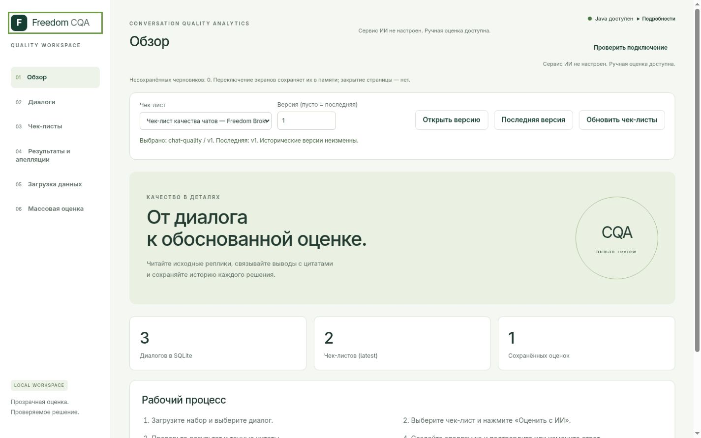
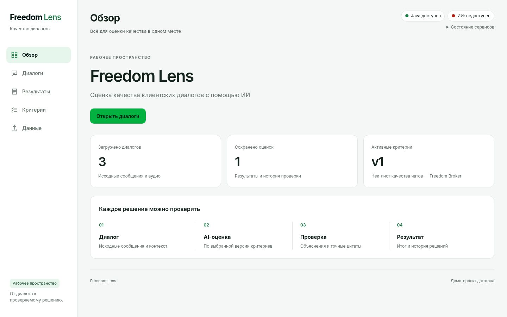

# Freedom Lens — UI/UX review and redesign

Scope: the existing Java-served Vanilla UI, from main `d0c0ac5` (PR17 merged).
No Java domain API, ML service, admission/grant, scoring, SQLite schema, Prompt v4,
contract or batch orchestration changes. No new build system, dependency or CDN.

## What the review found

| Before | Change and purpose |
| --- | --- |
| Six primary destinations, batch separated from saved results | Five destinations: Обзор, Диалоги, Результаты, Критерии, Данные. Saved results/batch share one contextual navigation row; old hashes still work. |
| Decorative hero/circle, English labels, repeated service/draft warnings | Freedom Lens wordmark, direct purpose, actual counts/current version and one context-aware action. Draft warning appears only when action is needed. |
| Checklist controls and three refresh/version actions above every page | One existing picker moves to the relevant workspace. Historical version controls are disclosed on demand; no cloned selectors or divergent state. |
| Four wide filters ahead of the conversation | Search and compact expandable filters in the list column. Mobile switches between list and transcript with an explicit back button. |
| Composite IDs used as titles | Numbered dialog labels and group/language tags. Original source IDs remain in details/data attributes, message IDs remain available beside untouched timestamps/text. Numbers are list labels, never persistence identifiers. |
| Result context/weights ahead of score, full evidence buttons | Score/100 first, pinned checklist, critical flag, concise criterion rows. Exact quotes remain available with evidence jump; weights/sections in calculation details. |
| All criterion fields/levels/sections open immediately | Compact criterion summaries; one click opens wording/instruction. Advanced type/ID/weight/N/A/levels remain available. Save appends a version, CAS/drafts are unchanged. |
| Appeal form always open; repeated Original/Final | Appeal creation opens on demand and reopens for retained drafts. A changed assessment explicitly labels Final and retains Original in its own disclosure, even when only explanation/evidence changed. |
| Batch warnings and repeated request metadata | Compact progress and separate blocked/error counts, technical details disclosed, dangerous retry actions styled separately. Required rubric and cost confirmations remain visible; runner/ledger behavior is unchanged. |

## Visual and accessibility decisions

References: [Freedom Bank](https://bankffin.kz/ru) and
[Freedom cash loan](https://loan-cash.freedombank.kz/). The supplied palette is an
approximation, not certified brand tokens. No official logo or marketing assets are used;
the footer identifies a datathon demo. White working surfaces, light background, bright
green primary actions with dark text, restrained borders and 10–16px radii replace the
previous decorative presentation. Inter is used when installed, then local system fonts;
there are no external font requests.

Native buttons, details/summary, labels, focus-visible and live status messages remain.
Invalid fields inside collapsed checklist sections reveal their containing sections.
Primary text/action contrast has an automated WCAG AA check; this is not an exhaustive
accessibility certification. Breakpoints target 1440×900, 1366×768, 768px and 390px.

## Verification approach

Existing workspace, auto and batch harnesses use only existing synthetic inputs and local
fake dependencies. The extended admission harness can adapt the six already committed ML
conversation fixtures without changing their text, roles, IDs or timestamps:

```bash
./server/mvnw -f server/pom.xml clean verify
node --experimental-default-type=module --test server/src/test/js/*.test.mjs
python3 -B server/src/test/python/workspace_smoke.py --serve
ml-service/.venv/bin/python -B server/src/test/python/admission_dev_smoke.py \
  --synthetic-fixtures --ml-python "$PWD/ml-service/.venv/bin/python" --serve
```

Run each printed browser harness in a fresh session. The latter uses actual Java/Python
HTTP, unchanged independent approval v2 gates and the existing isolated offline provider
with external networking blocked. Its disposable test grant is not real transfer consent.
Five existing chats are eligible; the existing voice fixture is blocked in this mode.
All model-shaped output is labelled OFFLINE TEST ONLY and proves no Groq quality.
The default dataset-based private harness remains available but is not run for this UI task.

The original regression assertions are retained; conversation selectors now use stable
`data-conversation-id` attributes instead of display titles. Test interactions open the same
native disclosure controls as users. Workspace checks additionally cover five-item navigation,
contextual batch, collapsed defaults, responsive overflow and mobile back navigation.

Screenshots are synthetic-only local artifacts, not customer-data exports. No DEV/CONTROL,
audio, signed links or provider requests are used in this redesign verification.

## Manual review path

1. Start the synthetic admission harness above and open its printed `/__tests/` address.
   Run the regression button; every model-shaped explanation says **OFFLINE TEST ONLY**.
2. Open `/` on that same local address. Обзор shows actual persisted counts; Открыть
   диалоги leads to the list. An empty database instead offers Загрузить данные.
3. Choose a chat. Its checklist/version and the AI action are next to the transcript;
   the required rubric confirmation stays visible. Expand ID details only if needed.
4. Open Результаты and a saved assessment. Read score/100, C01–C08, explanation and
   Показать доказательство. The exact source turn receives focus. Open Original for a
   reviewed assessment to compare it with Final; Оспорить оценку opens the appeal form.
5. In Критерии open one criterion summary, edit its wording and save a new version.
   Оценить по новой версии returns to the selected chat. Confirm that rubric separately;
   historical versions remain accessible under Версии и обновление списка.
6. Результаты → Массовая оценка opens the existing pinned batch. Explicit confirmation,
   pause/resume, status reconciliation and separate retry actions remain available.
7. At 390px, choose a dialog and use К списку диалогов to return. Check Tab/Enter with
   native buttons and disclosure summaries. Inspect calculation/technical details on demand.

Run the browser suite only once per disposable harness; it intentionally creates versions,
reviews and request history. Stop a harness before rebuilding its running JAR. No production
fake mode was added, and this review path does not authorize external processing.

## Executed checks — 2026-11-08

| Check | Result |
| --- | --- |
| Maven `clean verify` | BUILD SUCCESS; 5,996 JUnit, zero failures/errors/skips |
| JS unit tests | 32 PASS across four files, including existing ledger/batch and presentation tests plus CSS contrast |
| Contract validator | Four schemas, drift check and all 72 fixtures PASS; contract 2.0.0 untouched |
| Exact scoring reference | 5,184 PASS; scoring unchanged |
| Packaged storage/workspace HTTP smoke | PASS: static assets, source/checklist/manual/review persistence and restart from another working directory |
| Workspace browser | 14 PASS: source fidelity/XSS, stale responses, drafts, create lifecycle, CAS, evidence, review, mobile navigation and all six views at four widths |
| Auto browser | 6 PASS: readiness, one POST, failed/timeout, ledger restoration |
| Model review browser | 7 PASS: Original/Final, critical flag, CAS, arbitrary manual v2, history and JVM restart |
| Batch browser | 9 PASS: pinned scope, competing context, pause/reload, failed/unknown, no implicit retry, corrupt manifest |
| Actual Java/Python HTTP and browser | HTTP gates/persistence PASS; 9 browser scenarios PASS with existing six synthetic fixtures, five approved chats and one blocked call; v1→v2, explicit confirmation, review and batch/restart |

Browser runs use the in-app Chromium browser against real packaged Java and temporary
SQLite, with existing fake HTTP or the isolated offline Python provider as documented above.
These 45 browser scenarios are local checks, not GitHub CI browser coverage. The private
DEV-specific browser suite was adapted to the selectors but not run with customer data.
No real Organizer/audio/Groq calls were made. Screenshots and layout checks are not a full
cross-browser or assistive-technology audit; keyboard focus/semantic controls are retained,
and a complete screen-reader/keyboard matrix remains a manual review item.

During verification, an old product-name assertion was corrected. A browser run against a
JAR being replaced was discarded and rerun against a fresh process. The final UI also fixes
two navigation races: a delayed conversation cannot move the picker out of the active
criteria screen, and mobile read failures keep the back action available. Mobile selection
restores focus to that action instead of leaving it above the viewport.
The additional storage smoke initially exceeded its startup deadline while other JVMs
were starting; its isolated rerun passed without changing the deadline or test assertions.

## Screenshots (existing synthetic inputs only)

The overview pair uses the existing workspace fixtures. Dialog/result/editor views use
the existing ML fixtures with an isolated **OFFLINE TEST ONLY** provider. Numeric results
in these images test rendering/scoring/review; they are not model quality measurements.
The standard transfer confirmation remains visible even in this network-blocked test setup.

| Before, 1440×900 | Freedom Lens, 1440×900 |
| --- | --- |
|  |  |

- [Conversation and primary AI action, desktop](images/freedom-lens/dialog-desktop.png)
- [Score, evidence and Final, desktop](images/freedom-lens/result-desktop.png)
- [Criterion summaries, 1366×768](images/freedom-lens/criteria-laptop.png)
- [Conversation list, 390×844](images/freedom-lens/dialogs-mobile.png)
