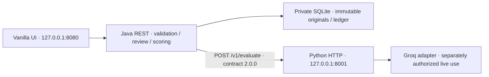

# Текущая архитектура Freedom CQA

Java 21 / Spring Boot 3.5.16 MVC + JDBC/SQLite обслуживает `/api` и HTML/CSS/Vanilla ES modules. Python/FastAPI — отдельный ML HTTP service, а не Fullstack backend. `backend/` и `frontend/` сохранены как legacy references; React/Vite и старый FastAPI не нужны для запуска.

## Границы

- Java pin-ит conversation и конкретный checklist key/version до HTTP, проверяет ответ независимо от Python и считает `cqa-score/1`. Write transaction не удерживается во время inference.
- Python получает сообщения и полный checklist; возвращает answers, exact evidence и diagnostics без численных totals. Audio URL и organizer credentials в этот payload не входят.
- Source roles/order/timestamps и позиционные IDs сохраняются; bot не становится operator. Evidence — непустая точная подстрока без нормализации. Это grounding, не доказательство смысловой релевантности.
- C08 — отдельный weightless flag. N/A удаляет только разрешённый вес из denominator. Java считает decimal/rational арифметикой с HALF_UP в конце; правила не менялись при подготовке релиза.

## Хранение и конкурентность

Java единолично владеет целевой SQLite. `conversations`, `checklists` и `evaluations` защищают исходные snapshots от UPDATE/DELETE. Checklist edits добавляют версии с CAS `expected_version`; существующий результат остаётся на прежней версии. Изменение импортируемого source под существующим composite ID даёт 409 и rollback.

`evaluation_reviews` и `appeals` содержат отдельную историю решений. Resolve требует `expected_revision`; успешные create/resolve увеличивают revision. Confirm сохраняет текущий ответ, change заменяет полный ответ и пересчитывает только final. Original не пересчитывается на GET. Concurrent/stale resolve — 409, без повторной отправки с новым revision.

`evaluation_requests` хранит UUID, payload identity, pinned input, status, result ID/error и diagnostics. Claim до HTTP; result и succeeded записываются атомарно. Повтор того же UUID не запускает inference. Другой payload с тем же UUID — 409. После crash pending становится unknown. Один Java-процесс владеет этой ML-базой; распределённого lease нет.

## Batch и UI

Batch фиксирует список IDs и checklist version, записывает intent в localStorage до POST, выполняет один item за раз. Web Locks исключают конкурирующие batch-вкладки на одном origin. Pause ждёт текущий запрос; reload только читает ledger и требует явного resume. Известные ошибки не теряются, retry создаёт новый UUID после явного подтверждения. Pending/unreadable блокируют отправку; unknown/404 требуют осознанного решения. Timeout не гарантирует отмену inference или однократную оплату.

Manifest содержит IDs/status, не transcripts/answers/credentials. Это browser orchestration, не серверная очередь. Требуются прежние origin/profile/SQLite; потеря site storage не восстанавливает очередь автоматически. Независимый API-клиент не участвует в browser lock.

## Политика данных и пределы

По умолчанию Java допускает ровно шесть bundled conversation/checklist pairs из `ml-service/tests/fixtures/*/request.json`; среди них есть v1 и одна существующая v2. Python отдельно проверяет fingerprints разговоров. Любые другие текст/IDs/checklist fields не становятся разрешёнными от имени группы SYNTHETIC. Новый динамический AI-criterion и реальные DEV/CONTROL требуют отдельного согласования, текущая policy не отключается.

Оба приложения слушают loopback, UI использует same-origin Java. Нет auth/production deployment, server-side batch workers, анализа интонации/дикции и достоверной company KB. Audio только по явному действию пользователя. Python health проверяет configuration/busy, Java health — только liveness. Safe Quick Start оставляет Python без ключа и честно недоступным для inference.

[Release evidence](RELEASE_READINESS.md) разделяет unit/integration/browser, fake provider и исторический live E2E. Direct dependencies и Maven pinned; транзитивные Python зависимости не зафиксированы полным hash lock. [Исторический аудит](CODEX_AUDIT.md) не описывает текущий runtime целиком.

BETA: отдельный `approved_dataset` режим проверяет приватный grant и точные snapshots; [правила и независимый Python blocker](BETA_READINESS.md). `/api/ai/status` читает ML health без inference.
